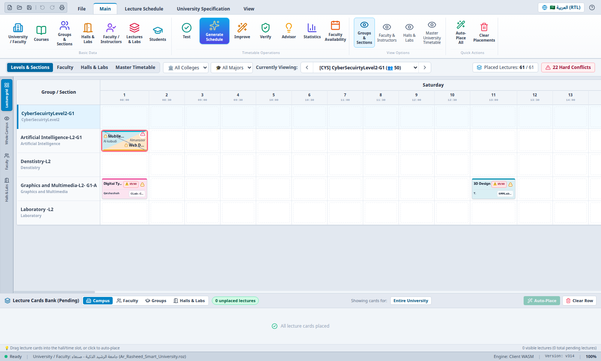
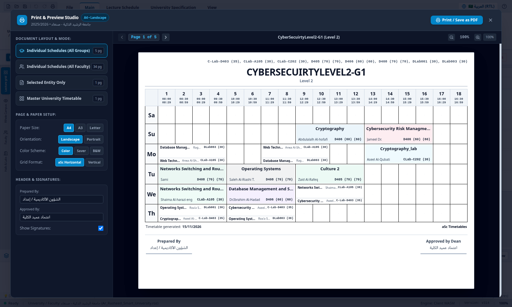
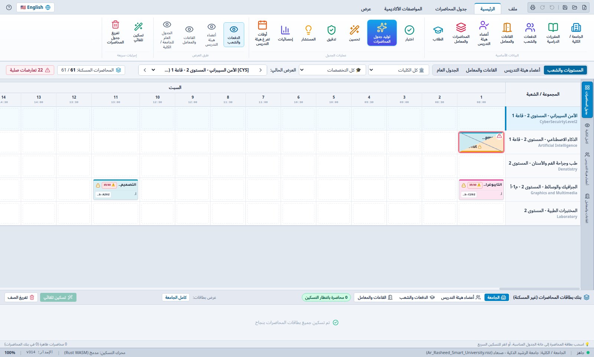
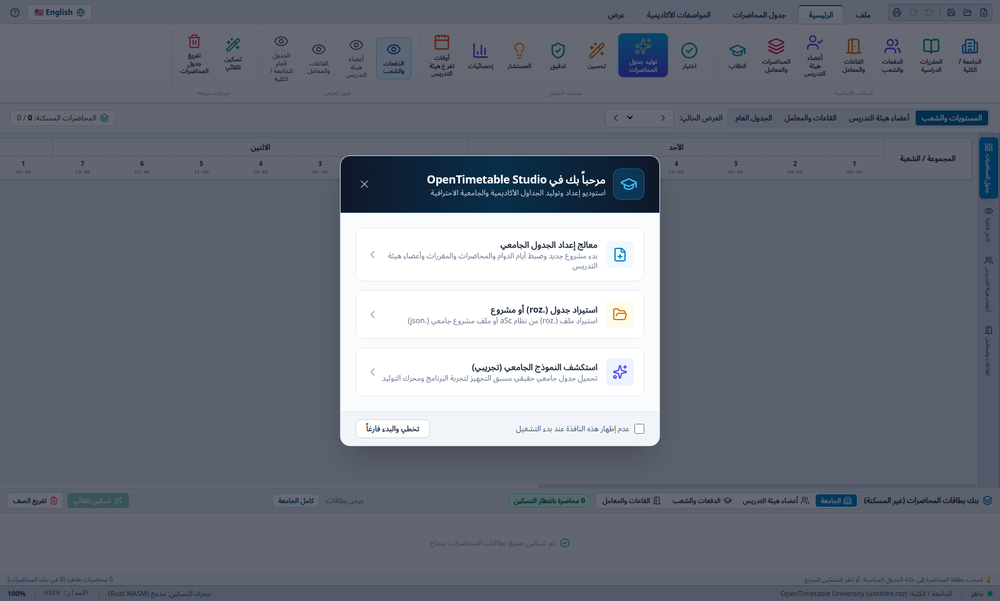

# OpenTimetable

> **University & Faculty Scheduling Studio** — A modern, high-performance academic timetable studio and constraint solver built for higher education institutions.

OpenTimetable combines a desktop-grade web studio (Next.js, React 19, TypeScript) with an ultrafast native Rust constraint solver compiled directly to WebAssembly (WASM). It supports university faculties, academic levels, specialized laboratories, lecture halls, and Dean-approved print exports.

---

## 📸 Screenshots

### Main Timetable Studio (English)
Full university schedule grid with ribbon operations, faculty workload indicators, and unplaced lecture cards bank.



### Print & Preview Studio (Dean Approval)
Interactive print mockup with customizable sheet layouts, A4/A3/Letter sizing, Dean signature blocks, and batch multi-page PDF generation.



### Bilingual Arabic (RTL) Studio
Full native Arabic localization for university departments, academic levels, lecture halls, and faculty titles.



### Startup Welcome & Sample Datasets
Immediate onboarding with real-world higher education sample datasets (including Ar-Rasheed Smart University with 18-period academic cycles, Dentistry, AI, Cybersecurity, and specialized labs).



---

## ✨ Key Features

- **🏛️ Higher Education Architecture**: Tailored for universities, colleges, academic levels, lecture halls, and specialized laboratories.
- **⚡ Rust WASM Constraint Solver**: High-speed, client-side constraint solving, automated lecture placement, and instant conflict diagnostics.
- **🖨️ Professional Print Studio**: Live sheet preview with "Approved by Dean" (`اعتماد عميد الكلية`) signature blocks, individual batch printing, and ink-saver modes.
- **🌐 Full Bilingual Support**: Instant toggle between English (LTR) and Arabic (RTL) with accurate academic terminology.
- **🔄 File & Format Interoperability**: Seamlessly imports and exports aSc Timetables binaries (`.roz`), UTF-8 matrix spreadsheets (CSV), and recurring calendar schedules (iCal).

---

## 🚀 Quick Start

### Prerequisites
- [Node.js](https://nodejs.org/) (v20+ recommended)
- [Rust & Cargo](https://rustup.rs/) and `wasm-pack` *(only required if modifying the solver)*

### Installation & Setup

```bash
# Clone the repository
git clone https://github.com/your-org/opentimetable.git
cd opentimetable

# Install web dependencies
npm --prefix apps/web install

# Run the development server
npm --prefix apps/web run dev
```

Open [http://localhost:3000](http://localhost:3000) in your browser.

### Building & Testing

```bash
# Build production web bundle
npm run build:web

# Run automated test suites
npm test
```

---

## 📁 Repository Structure

```text
├── apps/
│   └── web/              # Next.js 16 (React 19) Timetable Studio UI & components
├── crates/
│   ├── solver_core/      # Core Rust constraint engine and data structures
│   ├── solver_wasm/      # WebAssembly bindings for client-side solver execution
│   └── solver_cli/       # Command-line benchmark and solver testing harness
├── docs/
│   └── screenshots/      # High-resolution application screenshots
├── scripts/              # Utility and screenshot capture scripts
└── tests/                # Automated verification suites (Tiers 1-4, parsing, parity)
```
